<div align="center">



<br/>


</div>

---

hey. i like building things and then finding out why they broke.

most of it is **AI that does stuff** (agents, fine-tuned small models, eval harnesses, serving models without them falling over) and the rest is **hardware that does stuff** (firmware, PCBs, things that fly). the interesting part is usually where the two collide.

```text
 ┌──────────────────────────────────────────────┐
 │  status      : building                      │
 │  coffee      : yes                           │
 │  sleep       : negotiable                    │
 │  side quests : many                          │
 └──────────────────────────────────────────────┘
```

## 🧪 stuff i've made

| | |
|---|---|
| **[DocPilot](https://github.com/16bitOni/docpilot)** | collaborative document AI. [live here](https://docpilot-livid.vercel.app). |
| **[Gmail Assistant](https://github.com/16bitOni/gmail_assistant)** | an agent that reads your inbox and then does something about it: searches the web, checks your calendar, pings Slack, drafts replies. |
| **DipCompress** | a compression package with C extensions, on PyPI. yes i wrote C and shipped it. |
| **tiny SQL model** | fine-tuned a small model to write SQL. then built an eval harness to find out how wrong it was. |

more in the repos below. some are great, some are experiments, a few are crimes.

## 🕹️ playground

> nothing here is useful. that's the point.

<details>
<summary><b>▶ press start</b></summary>

<br/>

**pick a door:**

<details>
<summary>🚪 door 1</summary>

```text
      -o-   -o-
        \\_//
        [oo]      a drone.
                  it wobbles. it flies. it was a questionable idea.
                  naturally you do it again.
```

</details>

<details>
<summary>🚪 door 2</summary>

```text
   ┌───────────┐
   │ SELECT *  │   a small model writing SQL.
   │ FROM life │   mostly correct. confidence: unreasonable.
   │ WHERE ... │
   └───────────┘
```

</details>

<details>
<summary>🚪 door 3</summary>

```text
   $ sudo rm -rf /
   nice try.
   (the good ones don't fall for it either)
```

</details>

</details>

<details>
<summary><b>🐈 pet the cat</b></summary>

```text
   /\_/\
  ( o.o )   purrrrr
   > ^ <
```

you've been pinned as a person of taste.

</details>

<details>
<summary><b>🔮 ask the debugging oracle</b></summary>

```text
   .-"""-.
  /  ___  \
 |  (o o)  |   "have you tried printing the variable?"
  \  \_/  /
   '-...-'
```

it's always the variable.

</details>

<details>
<summary><b>⚠️ do not open</b></summary>

```text
   ¯\_(ツ)_/¯
```

told you.

</details>

## 🧰 toolbox

<div align="center">


</div>

<details>
<summary>the unabridged list</summary>

<br/>

C · C++ · Python · JavaScript · Elixir · Solidity · FastAPI · Express · Node · Next.js · EJS · Postgres · MongoDB · MySQL · SQLite · Elasticsearch · Firebase · PyTorch · TensorFlow · Keras · scikit-learn · SciPy · Pandas · NumPy · Plotly · Matplotlib · MLflow · OpenCV · CUDA · FFmpeg · Docker · AWS · Google Cloud · Render · Heroku · Netlify · Git · Arduino · Notion

</details>

## 📊 receipts

<div align="center">


</div>

## 📡 signal

[](https://linkedin.com/in/subhadipmondal89)
[](mailto:subhadipmondal789@gmail.com)
[](https://instagram.com/subhadip_x86)

<div align="center">

<sub>no cookies · no pitch · just vibes and commits</sub>

[](https://visitcount.itsvg.in)

</div>
