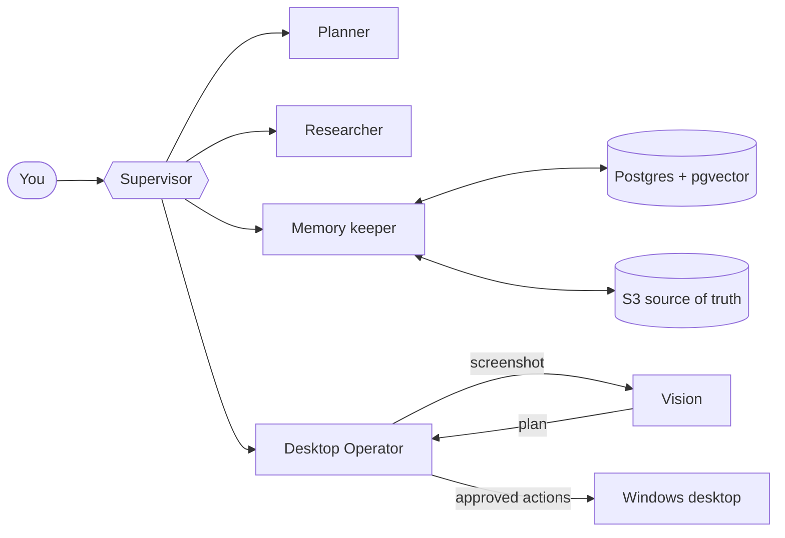

<div align="center">


<a href="https://git.io/typing-svg">
  
</a>

<br/>

[](https://linkedin.com/in/subhadipmondal89)
[](mailto:subhadipmondal789@gmail.com)
[](https://instagram.com/subhadip_x86)


</div>

---

```python
class Subhadip:
    location   = "Kolkata, India"
    education  = "B.E. Electronics & Communication, Chandigarh University"
    day_jobs   = ["AI Tutor @ xAI", "freelance AI agents + circuit design"]
    roots      = "Bengal"
    languages  = ["Python", "C/C++", "TypeScript", "Elixir", "Solidity"]
    obsessions = ["agents", "evals", "inference", "embedded systems"]
    looking_for = "Forward Deployed / Applied AI Engineer, early-stage, remote"
    long_game  = "found something of my own"

    def current_mode(self):
        return "ship > talk"
```

## 🔭 What I'm building right now

| Project | What it is | Stack |
|---|---|---|
| **Riki** | Multi-agent personal assistant. A supervisor routes work to planner, researcher and memory-keeper agents. Tiered long-term memory with hybrid retrieval. Includes a *Desktop Operator* that sees the screen, plans and acts on a real Windows desktop, with an allowlist and approval for risky steps. | FastAPI · LangGraph · AWS Bedrock · Postgres/pgvector · SQLAlchemy 2.0 async |
| **Handoff** | My entry for the Amazon Devices hackathon, Alexa+ track, built on the Desktop Operator work. | Python · Alexa+ |
| **Multi-tenant LLM inference** | Serving open models to many concurrent users: vLLM, hot-swappable LoRA adapters, and a proper load-characterization suite. | vLLM · LoRA · AWS |
| **Text-to-SQL with guardrails** | Fine-tuned small-model pipeline with a held-out eval harness (55 questions over Chinook) and checks that the SQL actually answers the question asked. | QLoRA · SageMaker · SQLite |
| **Job Radar** | Pulls Greenhouse, Lever and Ashby boards daily, classifies roles and detects hiring signals. I'm user #1: it finds me remote USD roles. | Python · scraping · classification |



## 🧪 Shipped

- **DipCompress**: a compression package with C extensions, published on PyPI. Wheels built with `cibuildwheel` and released through GitHub Actions OIDC trusted publishing, no tokens in secrets.
- **[DocPilot](https://github.com/16bitOni/docpilot)**: collaborative document AI platform. React + TypeScript front end, FastAPI back end, Supabase Postgres, Pinecone. [Live demo](https://docpilot-livid.vercel.app).
- **[Gmail Assistant](https://github.com/16bitOni/gmail_assistant)**: an LLM agent that reads inbox threads and chains tools across web search, Google Calendar, Slack and reply drafting.
- **QLoRA fine-tunes**: Phi-2 and Phi-3 for text-to-SQL, trained on SageMaker GPUs.
- **RAG and agent pipelines** in production-shaped form.

## 🛠️ Hardware side quest

Before the LLM era I was doing firmware and PCBs at a drone startup: **STM32 / ESP32** firmware, **KiCad** board design and **RTSP** video streaming. I still do circuit design on the side. It keeps my software honest about latency, memory and things that physically break.

## 🧰 Toolbox

<div align="center">


</div>

<details>
<summary><b>The full list, including the less glamorous parts</b></summary>

<br/>

| Area | Things I use |
|---|---|
| **LLM / agents** | LangGraph, AWS Bedrock, tool use, MCP, RAG (hybrid retrieval), evals, QLoRA / Unsloth, vLLM |
| **ML** | PyTorch, TensorFlow, Keras, scikit-learn, SciPy, MLflow, CUDA |
| **Data** | Pandas, NumPy, Plotly, Matplotlib, SQL |
| **Backend** | FastAPI, Node / Express, Next.js, EJS, SQLAlchemy, Alembic, Pydantic |
| **Datastores** | Postgres + pgvector, MongoDB, MySQL, SQLite, Elasticsearch, Pinecone, Firebase |
| **Infra** | AWS, GCP, Docker, GitHub Actions, Render, Heroku, Netlify, Vercel |
| **Systems / HW** | C, C++, STM32, ESP32, Arduino, KiCad, FFmpeg, OpenCV |
| **Other** | Elixir, Solidity, Notion, Git |

</details>

## 📊 Numbers, for the people who like numbers

<div align="center">


</div>

## 🎯 Working with me

I'm after **Forward Deployed Engineer** and **Applied AI Engineer** roles at early-stage startups, remote preferred. I'm at my best when the problem is messy and the customer is real: take a vague need, build the thing, put it in front of users, measure it honestly.

Good reasons to message me:
- you need an agent that works on real tasks, not just demos
- you want a model fine-tuned, served and evaluated end to end
- your product touches hardware and AI at the same time
- you're building something early and need someone who ships

<div align="center">


<sub>Built in Kolkata. Powered by chai and stubbornness.</sub>

</div>
