

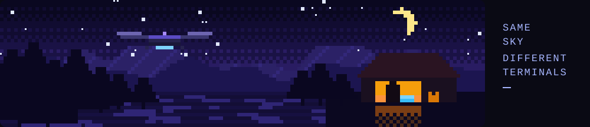
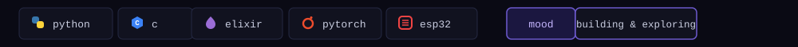
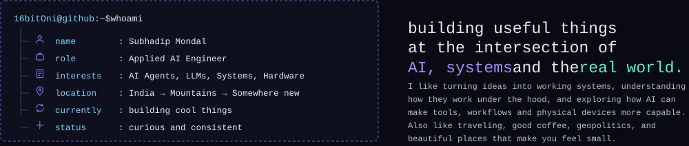
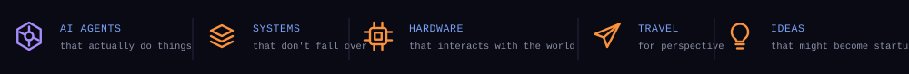

<a href="https://github.com/16bitOni?tab=repositories">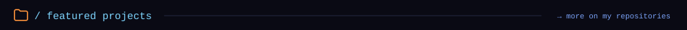</a>

<table width="100%">
<tr>
<td width="25%" align="center" valign="top">
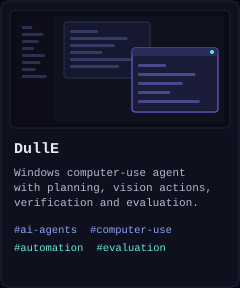 
<a href="https://github.com/16bitOni?tab=repositories">Code →</a> &nbsp;·&nbsp; <a href="https://github.com/16bitOni?tab=repositories">Details →</a>
</td>
<td width="25%" align="center" valign="top">
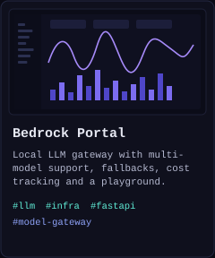 
<a href="https://github.com/16bitOni?tab=repositories">Code →</a> &nbsp;·&nbsp; <a href="https://github.com/16bitOni?tab=repositories">Details →</a>
</td>
<td width="25%" align="center" valign="top">
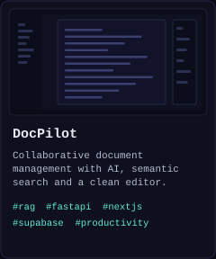 
<a href="https://github.com/16bitOni/docpilot">Code →</a> &nbsp;·&nbsp; <a href="https://docpilot-livid.vercel.app">Details →</a>
</td>
<td width="25%" align="center" valign="top">
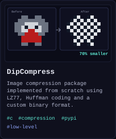 
<a href="https://github.com/16bitOni?tab=repositories">Code →</a> &nbsp;·&nbsp; <a href="https://github.com/16bitOni?tab=repositories">Details →</a>
</td>
</tr>
</table>

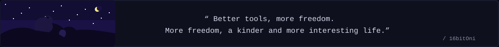

<table width="100%">
<tr>
<td width="50%" valign="top" align="center">
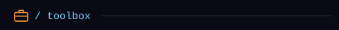 

</td>
<td width="50%" valign="top" align="center">
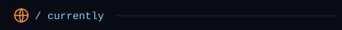 
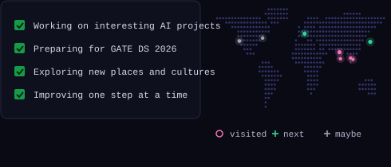
</td>
</tr>
</table>

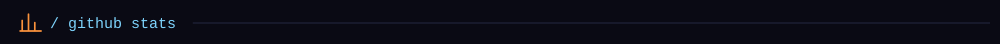

<table width="100%">
<tr>
<td width="33%" align="center" valign="top"></td>
<td width="33%" align="center" valign="top"></td>
<td width="33%" align="center" valign="top"></td>
</tr>
</table>

<table>
<tr>
<td></td>
<td></td>
<td><a href="https://instagram.com/subhadip_x86">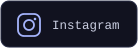</a></td>
<td></td>
</tr>
</table>

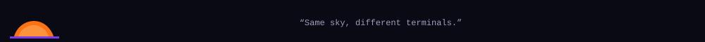

