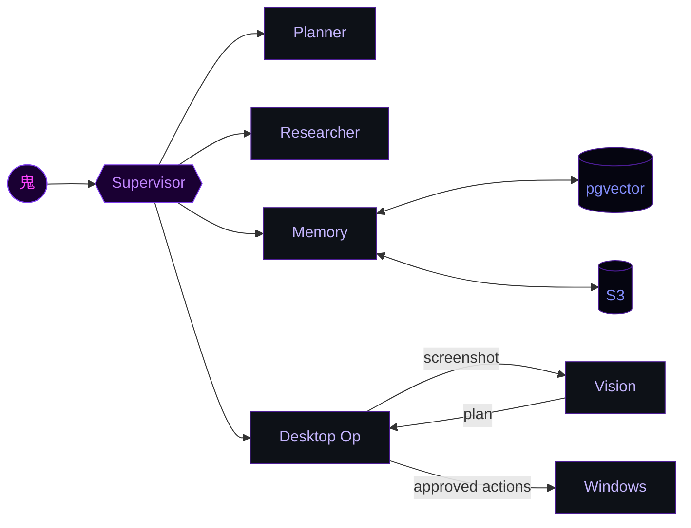

<div align="center">


</div>

```
  ╔══════════════════════════════════════════════════════════════════╗
  ║                    ▄██▄   ▄██▄                                   ║
  ║                   ██████ ██████                                  ║
  ║              ▄████████████████████▄                              ║
  ║            ██  ░░░░░░░░░░░░░░░░░░  ██                           ║
  ║           ██    ▒▓███▒   ▒▓███▒     ██                          ║
  ║           ██     ▀███▀   ▀███▀      ██                          ║
  ║           ██       ░░  ▽  ░░        ██                          ║
  ║           ██    ╔══════════════╗    ██                          ║
  ║            ██   ║▐▌ ▐▌ ▐▌ ▐▌  ║   ██                           ║
  ║             ▀██ ╚══════════════╝ ██▀                            ║
  ║                                                                  ║
  ║         SUBHADIP  ·  16bitOni  ·  鬼  ·  DAEMON ENGINEER        ║
  ╚══════════════════════════════════════════════════════════════════╝
```

<div align="center">

<a href="https://git.io/typing-svg">
  
</a>

<br/>

[](https://linkedin.com/in/subhadipmondal89)
[](mailto:subhadipmondal789@gmail.com)
[](https://instagram.com/subhadip_x86)


</div>

---

```bash
$ oni --boot --mode=engineer

[████████████████████] 100%

  IDENTITY .......... subhadip mondal
  ALIAS ............. 16bitOni  /  鬼
  ORIGIN ............ kolkata, bengal, india
  SUBSTRATE ......... B.E. ECE, Chandigarh University
  CURRENT OPS ....... AI Tutor @ xAI  ·  freelance agents  ·  circuits
  LANGUAGES ......... Python  ·  C/C++  ·  TypeScript  ·  Elixir  ·  Solidity
  DIRECTIVE ......... ship > talk

> daemon loaded. systems nominal.
```

---

## ⚙ ACTIVE PROCESSES

```
 PID    DAEMON               STATUS      STACK
 ─────────────────────────────────────────────────────────────────────────────
 0x001  riki                 RUNNING ▶   LangGraph · Bedrock · Postgres/pgvector
                             ↳ supervisor routes work: planner · researcher · memory-keeper
                             ↳ Desktop Operator: sees screen, plans, acts on Windows
                             ↳ tiered long-term memory + hybrid retrieval

 0x002  handoff              TESTING ▶   Python · Alexa+
                             ↳ Amazon Devices hackathon · Alexa+ track
                             ↳ built on top of Desktop Operator

 0x003  llm-inference-mt     RUNNING ▶   vLLM · hot-swap LoRA · AWS
                             ↳ serving open models to concurrent users
                             ↳ load-characterization suite included

 0x004  text-to-sql          RUNNING ▶   QLoRA · SageMaker · SQLite
                             ↳ fine-tuned small-model pipeline
                             ↳ 55-question eval harness over Chinook

 0x005  job-radar            RUNNING ▶   Python · scraping · classification
                             ↳ pulls Greenhouse + Lever + Ashby daily
                             ↳ I am user #1
```



---

## 🗡 ARTIFACTS  *(shipped, real, in the wild)*

| artifact | what it is |
|---|---|
| **DipCompress** | compression lib with C extensions · published on PyPI · wheels via `cibuildwheel` · OIDC trusted publishing, zero tokens in secrets |
| **[DocPilot](https://github.com/16bitOni/docpilot)** | collaborative document AI · React + TypeScript front end · FastAPI back end · Supabase + Pinecone · [live ↗](https://docpilot-livid.vercel.app) |
| **[Gmail Assistant](https://github.com/16bitOni/gmail_assistant)** | LLM agent over inbox threads · chains web search · Google Calendar · Slack · reply drafting |
| **QLoRA fine-tunes** | Phi-2 + Phi-3 for text-to-SQL · trained on SageMaker GPUs · eval harness included |
| **RAG + agent pipelines** | production-shaped · not toy demos |

---

## ⚡ PHYSICAL LAYER

```
before the LLM era, the work was in the metal.

drone startup — STM32 + ESP32 firmware · KiCad board design · RTSP video streaming.
still do circuit design on the side.
it keeps the software honest about latency, memory, and things that physically break.
```

---

## 🔮 ARSENAL

<div align="center">


</div>

<details>
<summary><b>▶ open grimoire</b></summary>

<br/>

| domain | weapons |
|---|---|
| **LLM / agents** | LangGraph · AWS Bedrock · tool use · MCP · RAG (hybrid retrieval) · evals · QLoRA · Unsloth · vLLM |
| **ML** | PyTorch · TensorFlow · Keras · scikit-learn · SciPy · MLflow · CUDA |
| **data** | Pandas · NumPy · Plotly · Matplotlib · SQL |
| **backend** | FastAPI · Node/Express · Next.js · EJS · SQLAlchemy · Alembic · Pydantic |
| **datastores** | Postgres + pgvector · MongoDB · MySQL · SQLite · Elasticsearch · Pinecone · Firebase |
| **infra** | AWS · GCP · Docker · GitHub Actions · Render · Heroku · Vercel · Netlify |
| **systems / hw** | C · C++ · STM32 · ESP32 · Arduino · KiCad · FFmpeg · OpenCV |
| **other** | Elixir · Solidity · Git |

</details>

---

## 📡 SIGNAL

<div align="center">


</div>

---

<div align="center">


```
PROCESS 16bitOni  —  STATUS: RUNNING  —  UPTIME: ∞  —  ORIGIN: kolkata, bengal
```

<sub>built here. powered by chai and stubbornness.</sub>

</div>
